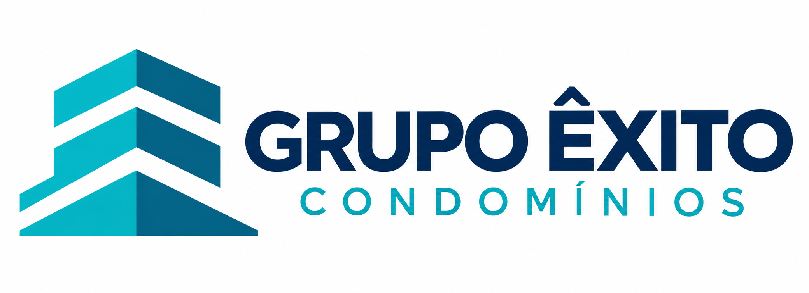

# Grupo Êxito Condomínios - Site Institucional

> **Projeto exclusivamente para fins de estudo.**

Projeto desenvolvido para a faculdade de **Engenharia de Software**.

O objetivo é desenvolver, em grupo, um site institucional para uma administradora de condomínios, utilizando **HTML, CSS e JavaScript**.

Este projeto não representa o site oficial da empresa e não possui finalidade comercial. Os textos, números, clientes, projetos, notícias e demais informações utilizadas no site são fictícios e foram criados apenas para fins acadêmicos.

---

## Equipe e divisão das páginas

O projeto possui **11 integrantes**, sendo cada integrante responsável pelo desenvolvimento de uma página.

A ideia é que cada pessoa tenha sua própria página para desenvolver, mas todos sigam a mesma estrutura visual e organização do projeto.

| Página                     | Responsável        | Tarefa                                                     |
| -------------------------- | ------------------ | ---------------------------------------------------------- |
| Home                       | **Alexander**      | [ClickUp](https://app.clickup.com/t/90171541460/86e39d6z7) |
| Quem Somos                 | **Anthony**        | [ClickUp](https://app.clickup.com/t/90171541460/86e39d6z6) |
| Clientes                   | **Gabriel**        | [ClickUp](https://app.clickup.com/t/90171541460/86e39dj32) |
| Serviços — Vitrine         | **João**           | [ClickUp](https://app.clickup.com/t/90171541460/86e39dj5t) |
| Serviços 1                 | **Arthur**         | [ClickUp](https://app.clickup.com/t/90171541460/86e39djak) |
| Serviços 2                 | **Felipe Dias**    | [ClickUp](https://app.clickup.com/t/90171541460/86e39djcu) |
| Serviços 3                 | **David**          | [ClickUp](https://app.clickup.com/t/90171541460/86e39djf1) |
| Perguntas Frequentes — FAQ | **Evandro**        | [ClickUp](https://app.clickup.com/t/90171541460/86e39djn2) |
| Contatos                   | **Pablo**          | [ClickUp](https://app.clickup.com/t/90171541460/86e39djrr) |
| Clientes — Projetos        | **Felipe Gabriel** | [ClickUp](https://app.clickup.com/t/90171541460/86e39djva) |
| Notícias                   | **Enzo**           | [ClickUp](https://app.clickup.com/t/90171541460/86e39dk07) |

### Responsabilidade de cada integrante

Cada integrante é responsável por:

* Desenvolver o HTML da sua página.
* Criar e organizar o conteúdo da página.
* Desenvolver o CSS necessário para sua página.
* Utilizar as cores e padrões definidos pelo grupo.
* Adicionar as imagens necessárias.
* Garantir que os links da página estejam funcionando.
* Verificar a visualização em diferentes tamanhos de tela.
* Manter o código organizado e indentado.
* Fazer commits claros e relacionados ao que foi desenvolvido.
* Avisar o grupo caso precise alterar alguma estrutura compartilhada.

### Importante

Cada integrante deve trabalhar principalmente na sua própria página.

Caso seja necessário alterar:

* Header;
* Footer;
* Paleta de cores;
* Estrutura de pastas;
* Classes compartilhadas;
* Componentes utilizados por outras páginas;

é importante conversar com o grupo antes para evitar que uma alteração quebre o trabalho de outra pessoa.

---

# Estrutura do projeto

```text
grupoexitocondominios/
│
├── index.html                  # Home
├── favicon.ico                 # Ícone da aba do navegador
│
├── css/
│   ├── paleta.css              # Cores, fontes e medidas do projeto (compartilhado)
│   ├── componentes.css         # Botões, cards, etiquetas... prontos (compartilhado, opcional)
│   ├── layout.css              # Header (menu) e footer das páginas (compartilhado)
│   ├── confirmacao.css         # Tela de confirmação de formulário
│   ├── clientes.css            # Página Clientes
│   ├── contato.css             # Página Contato
│   ├── adm.css                 # Página Fale Conosco (adm-contato)
│   └── servicos-1.css          # Página Serviços 1
│
├── js/
│   ├── menu.js                 # Abre/fecha o menu no celular (compartilhado)
│   └── formulario.js           # Envio de formulário -> tela de confirmação (compartilhado)
│
├── img/
│   ├── favicon/                # Ícones do site (gerados a partir do logo)
│   ├── clientes/               # Imagens da página Clientes
│   └── ...                     # Logos, banners, projetos e notícias
│
├── pages/
│   ├── quem-somos.html
│   ├── clientes.html
│   ├── servicos.html
│   ├── servicos-1.html
│   ├── servicos-2.html
│   ├── servicos-3.html
│   ├── projetos.html
│   ├── noticias.html
│   ├── faq.html
│   ├── contato.html
│   ├── adm-contato.html
│   └── confirmacao.html        # Tela mostrada depois de enviar um formulário
│
└── docs/
    ├── README.md               # Este documento
    └── giti-para-iniciantes.pdf # Material de apoio sobre Git
```

> Arquivos marcados como **compartilhado** são usados por várias páginas. Antes de alterar, avise o grupo (veja as [Regras básicas do grupo](#regras-básicas-do-grupo)).

### O que fica em cada pasta?

**`index.html`**

Página inicial do site.

**`pages/`**

Contém as páginas internas do projeto. Cada integrante possui uma página para desenvolver.

**`css/`**

Contém os arquivos CSS compartilhados pelo projeto.

**`img/`**

Local onde devem ficar as imagens utilizadas no site.

**`js/`**

Arquivos JavaScript utilizados para comportamentos e interações do site.

**`docs/`**

Documentação do projeto: este README e materiais de apoio, como o PDF de Git para iniciantes.

---

# Organização do CSS

Como o grupo está começando a trabalhar com CSS, a ideia é manter a estrutura simples.

Não é necessário criar uma estrutura complicada de arquivos.

A prioridade neste momento é aprender e praticar:

* Seletores;
* Classes;
* IDs;
* Cores;
* Fontes;
* Margens;
* Espaçamentos;
* `padding`;
* `border`;
* `border-radius`;
* `width` e `height`;
* `display`;
* Flexbox;
* Grid;
* Posicionamento;
* Responsividade;
* Pseudo-classes como `:hover`.

---

## Paleta de cores

As cores principais do projeto ficam centralizadas no arquivo:

```text
css/paleta.css
```

Isso evita que cada integrante escolha uma cor diferente para cada página.

Cores do projeto:

| Cor                 | Valor RGB            | Onde usar                              |
| ------------------- | -------------------- | -------------------------------------- |
| Navy profundo       | `rgb(6, 21, 45)`     | Header, rodapé, botões principais      |
| Navy superfície     | `rgb(10, 30, 59)`    | Cards sobre fundo escuro               |
| Navy claro          | `rgb(14, 56, 103)`   | Hover e variações                      |
| Ciano elétrico      | `rgb(0, 188, 212)`   | Ícones, links ativos, detalhes         |
| Teal                | `rgb(0, 104, 118)`   | Títulos de seção, links em fundo claro |
| Teal vibrante       | `rgb(24, 168, 182)`  | Gradientes e ilustrações               |
| Ciano suave         | `rgb(214, 247, 255)` | Fundo de etiquetas e badges            |
| Fundo               | `rgb(248, 250, 253)` | Fundo da página                        |
| Superfície          | `rgb(255, 255, 255)` | Cards, formulários                     |
| Superfície variante | `rgb(241, 245, 249)` | Blocos secundários, inputs             |
| Borda               | `rgb(226, 232, 240)` | Bordas e divisórias                    |
| Texto               | `rgb(6, 21, 45)`     | Títulos e texto forte                  |
| Texto corpo         | `rgb(71, 85, 105)`   | Parágrafos                             |
| Texto secundário    | `rgb(82, 96, 113)`   | Legendas, textos de apoio              |
| Texto suave         | `rgb(148, 163, 184)` | Placeholders, metadados                |
| Texto invertido     | `rgb(255, 255, 255)` | Texto sobre fundo navy                 |
| Sucesso             | `rgb(16, 185, 129)`  | Confirmação, WhatsApp                  |
| Alerta              | `rgb(245, 158, 11)`  | Avisos                                 |
| Erro                | `rgb(239, 68, 68)`   | Erros de formulário                    |

Na sua página, basta copiar o valor da cor:

```css
.titulo {
    color: rgb(6, 21, 45);
}

.botao {
    background-color: rgb(0, 188, 212);
}

.card {
    background-color: rgb(255, 255, 255);
    border: 1px solid rgb(226, 232, 240);
}
```

Precisa de transparência? Use `rgba` e acrescente um quarto valor, de `0` (invisível) a `1` (sólido):

```css
.fundo-destaque {
    background-color: rgba(0, 188, 212, 0.15);
}
```

---

# Componentes compartilhados

O arquivo:

```text
css/componentes.css
```

pode conter estilos de elementos que aparecem em várias páginas.

Por exemplo:

* Botões;
* Cards;
* Tags;
* Formulários;
* Títulos;
* Containers;
* Seções.

Exemplo:

```css
.ex-botao {
    display: inline-block;
    padding: 12px 24px;
    border-radius: 12px;
    text-decoration: none;
    font-weight: 600;
}

.ex-botao--primario {
    background-color: rgb(0, 188, 212);
    color: rgb(6, 21, 45);
}
```

Na página:

```html
<a href="contato.html" class="ex-botao ex-botao--primario">
    Solicitar proposta
</a>
```

Se você precisar criar algo específico para sua página, pode criar uma classe própria.

Exemplo:

```css
.clientes-destaque {
    ...
}
```

Não é necessário tentar transformar todos os elementos em componentes compartilhados.

---

# Header, footer e estrutura das páginas

Todas as páginas internas usam o **mesmo header (menu) e o mesmo footer** da home, para o site ficar com a mesma cara.

* O visual fica em `css/layout.css`.
* O menu vira um botão no celular (abaixo de 1024px), controlado por `js/menu.js`.
* No celular, o logo fica maior e centralizado.

### O que cada página precisa ter

**Dentro do `<head>`** (depois do `<meta name="viewport">`):

```html
<title>Nome da Página | Grupo Êxito Condomínios</title>
<meta name="description" content="Uma frase descrevendo a página.">
<meta name="robots" content="noindex, nofollow">
<meta name="theme-color" content="#06152d">
<link rel="icon" href="../favicon.ico" sizes="any">
<link rel="icon" type="image/png" sizes="32x32" href="../img/favicon/favicon-32.png">
<link rel="apple-touch-icon" href="../img/favicon/apple-touch-icon.png">
<link rel="manifest" href="../img/favicon/site.webmanifest">

<!-- Fontes -->
<link rel="preconnect" href="https://fonts.googleapis.com">
<link rel="preconnect" href="https://fonts.gstatic.com" crossorigin>
<link rel="stylesheet" href="https://fonts.googleapis.com/css2?family=Plus+Jakarta+Sans:wght@300;400;500;600;700;800&family=Space+Grotesk:wght@500;600;700&display=swap">
<link rel="stylesheet" href="https://fonts.googleapis.com/css2?family=Material+Symbols+Outlined:opsz,wght,FILL,GRAD@20..48,100..700,0..1,-50..200">

<!-- CSS compartilhado (nesta ordem) -->
<link rel="stylesheet" href="../css/paleta.css">
<link rel="stylesheet" href="../css/layout.css">

<!-- Depois, o CSS da SUA página -->
<link rel="stylesheet" href="../css/sua-pagina.css">
```

**Dentro do `<body>`:**

1. Logo no começo, o bloco `<!-- HEADER COMPARTILHADO -->`.
2. O conteúdo da sua página, de preferência dentro de `<main>`.
3. No fim, o bloco `<!-- FOOTER COMPARTILHADO -->` e os scripts:

```html
<script src="../js/menu.js"></script>
<!-- só se a página tiver formulário: -->
<script src="../js/formulario.js"></script>
```

### Como criar uma página nova

O jeito mais fácil é **copiar uma página que já existe** (ex.: `pages/faq.html`), manter o `<head>`, o header e o footer, e trocar só o conteúdo do meio.

No menu, a página atual fica destacada com `aria-current="page"`:

```html
<a class="ex-menu__link" href="faq.html" aria-current="page">FAQ</a>
```

Se for preciso **adicionar ou renomear um item do menu**, o menu tem que ser alterado na home e em **todas** as páginas (no menu desktop, no menu mobile e no footer). Combine com o grupo antes.

### Cuidados com o CSS da sua página

O header e o footer usam classes que começam com `ex-` (`.ex-header`, `.ex-rodape`...) para o CSS de cada página não mexer neles. Mesmo assim, evite regras muito genéricas que afetem a página inteira, como:

```css
/* evite: muda o body inteiro (e pode empurrar o header/footer) */
body { display: flex; padding: 40px; }

/* prefira: aplique no seu próprio conteúdo */
main { display: flex; padding: 40px; }
.minha-secao img { width: 100%; }
```

---

# Recursos do site

### Formulários e tela de confirmação

Ainda não há back-end (o formulário não envia para lugar nenhum). Formulários com `data-confirmacao` guardam os dados no navegador e abrem `pages/confirmacao.html`, que mostra protocolo, resumo e próximos passos:

```html
<form action="confirmacao.html" method="get" data-confirmacao="Fale conosco">
    <label for="nome">Nome</label>
    <input id="nome" name="nome" autocomplete="name" required>
    ...
</form>
<script src="../js/formulario.js"></script>
```

Cada campo precisa de `name` e de um `<label for="...">` para aparecer no resumo.

---

# Padrão de HTML

Procurem utilizar HTML semântico.

Em vez de criar tudo utilizando apenas `div`, utilizem elementos que representem o conteúdo.

Exemplo:

```html
<header>
    ...
</header>

<main>

    <section>
        <h1>Quem somos</h1>

        <p>
            Conheça a nossa empresa.
        </p>
    </section>

    <section>
        ...
    </section>

</main>

<footer>
    ...
</footer>
```

Algumas tags importantes:

| Tag             | Utilização            |
| --------------- | --------------------- |
| `<header>`      | Cabeçalho             |
| `<nav>`         | Menu de navegação     |
| `<main>`        | Conteúdo principal    |
| `<section>`     | Seção de conteúdo     |
| `<article>`     | Conteúdo independente |
| `<aside>`       | Conteúdo complementar |
| `<footer>`      | Rodapé                |
| `<h1>`          | Título principal      |
| `<h2>`          | Título de seção       |
| `<h3>`          | Subtítulo             |
| `<p>`           | Parágrafo             |
| `<a>`           | Link                  |
| `<button>`      | Botão/ação            |
| `<ul>` / `<li>` | Listas                |
| ``         | Imagens               |

---

# Responsividade

As páginas precisam funcionar em diferentes tamanhos de tela.

Durante o desenvolvimento, testem pelo menos:

* Computador;
* Tablet;
* Celular.

Exemplo simples de Media Query:

```css
.card {
    width: 50%;
}

@media (max-width: 768px) {
    .card {
        width: 100%;
    }
}
```

A ideia é começar simples e ir melhorando conforme o grupo aprender mais sobre CSS.

Não é necessário tentar deixar o site perfeito em todos os dispositivos logo no primeiro momento.

---

# Imagens

Todas as imagens utilizadas no projeto devem ficar dentro da pasta:

```text
img/
```

Exemplo:

```text
img/
├── logo/
├── clientes/
├── projetos/
└── noticias/
```

Nas páginas internas:

```html

```

Use sempre **caminhos relativos** ao projeto. Caminhos do seu computador (ex.: `C:\Users\seu-nome\Downloads\foto.png`) só funcionam na sua máquina e quebram para o resto do grupo.

Se o nome do arquivo tiver espaços, troque cada espaço por `%20` no `src` (ou, melhor, renomeie o arquivo sem espaços).

Evitem utilizar imagens diretamente de sites externos.

Também é importante sempre preencher o atributo `alt`:

```html

```

O `alt` deve descrever o conteúdo da imagem.

---

# Links entre as páginas

Na página inicial:

```html
<a href="pages/quem-somos.html">
    Quem Somos
</a>
```

Dentro da pasta `pages/`:

```html
<a href="quem-somos.html">
    Quem Somos
</a>
```

Para voltar para a página inicial:

```html
<a href="../index.html">
    Início
</a>
```

Antes de finalizar sua tarefa, teste todos os links da sua página.

---

# Tecnologias

O projeto utiliza:

* **HTML5**
* **CSS3**
* **JavaScript** (puro, sem bibliotecas)
* **Google Fonts** (Plus Jakarta Sans e Space Grotesk)
* **Material Symbols** (ícones)
* **Git**
* **GitHub**

O projeto está sendo desenvolvido inicialmente com foco em **HTML e CSS**. O JavaScript será utilizado quando houver necessidade de interação e comportamento na página.

Todos os recursos são **gratuitos** e não precisam de instalação nem de chave de API.

---

# Como executar o projeto

Não é necessário instalar nenhuma ferramenta específica para visualizar o site.

Basta abrir:

```text
index.html
```

no navegador.

Também recomendamos utilizar a extensão **Live Server** no VS Code.

Com o Live Server, ao salvar uma alteração no código, o navegador pode atualizar automaticamente a página.

Dicas:

* Se uma alteração de CSS não aparecer, recarregue sem cache: **Ctrl + Shift + R**.

---

# Para quem está começando no CSS

Não precisa tentar decorar todas as propriedades CSS.

O mais importante neste projeto é entender o que cada propriedade está fazendo.

Por exemplo:

```css
.card {
    background-color: white;
    padding: 20px;
    margin: 20px;
    border-radius: 12px;
}
```

Aqui:

* `background-color`: define a cor do fundo;
* `padding`: espaço interno;
* `margin`: espaço externo;
* `border-radius`: arredonda os cantos.

Depois, podemos evoluir para Flexbox:

```css
.container {
    display: flex;
    gap: 20px;
}
```

E posteriormente para Grid:

```css
.container {
    display: grid;
    grid-template-columns: repeat(3, 1fr);
    gap: 20px;
}
```

A ideia é **aprender fazendo**.

Não há problema em consultar documentação, exemplos ou pedir ajuda para entender uma propriedade.

O importante é entender o código que está sendo utilizado.

---

# Git e GitHub

Cada integrante deve trabalhar na sua própria branch.

Antes de começar a trabalhar:

```bash
git pull
```

Depois de realizar suas alterações:

```bash
git status
```

Verifique os arquivos alterados:

```bash
git add .
```

Faça o commit:

```bash
git commit -m "feat: adiciona seção de clientes"
```

E envie sua branch:

```bash
git push
```

### Exemplos de mensagens de commit

```text
feat: adiciona estrutura da página de notícias
```

```text
feat: adiciona seção de clientes
```

```text
style: ajusta responsividade dos cards
```

```text
fix: corrige links da página de contato
```

```text
chore: organiza imagens do projeto
```

Procurem fazer commits pequenos e que representem uma alteração específica.

---

# Regras básicas do grupo

1. Cada integrante deve trabalhar principalmente na sua própria página.
2. Não apagar ou modificar o código de outra pessoa sem conversar antes.
3. Não alterar arquivos compartilhados sem avisar o grupo.
4. Manter o código organizado e indentado.
5. Utilizar a paleta de cores definida pelo projeto.
6. Utilizar imagens dentro da pasta `img/`.
7. Utilizar HTML semântico sempre que possível.
8. Testar os links antes de enviar a alteração.
9. Testar a página em diferentes tamanhos de tela.
10. Fazer commits pequenos e com mensagens claras.
11. Fazer `git pull` antes de começar uma nova sessão de desenvolvimento.
12. Em caso de conflito no Git, não apagar alterações de outra pessoa sem verificar primeiro.
13. Se tiver dúvida, perguntar antes de fazer uma alteração que possa afetar o restante do projeto.

---

# Controle das tarefas

As tarefas de cada página estão organizadas no **ClickUp**.

Cada integrante deve acompanhar sua tarefa para verificar:

* O que precisa ser desenvolvido;
* Conteúdo da página;
* Status da atividade;
* Pendências;
* Ajustes solicitados;
* Entrega.

Os tickets estão disponíveis na tabela de **Equipe e divisão das páginas** no início deste documento.

---

# Objetivo do projeto

Além de desenvolver o site, o projeto tem como objetivo praticar:

* Desenvolvimento Front-end;
* HTML semântico;
* CSS;
* Responsividade;
* JavaScript;
* Git e GitHub;
* Organização de projetos;
* Trabalho em equipe;
* Divisão de tarefas;
* Code review;
* Resolução de conflitos;
* Versionamento de código.

O projeto será desenvolvido de forma gradual, começando pela estrutura HTML e evoluindo posteriormente para CSS e JavaScript.

---

<sub>Projeto acadêmico — Engenharia de Software. Marcas e nomes citados pertencem aos seus respectivos donos e são utilizados apenas para fins educacionais.</sub>
